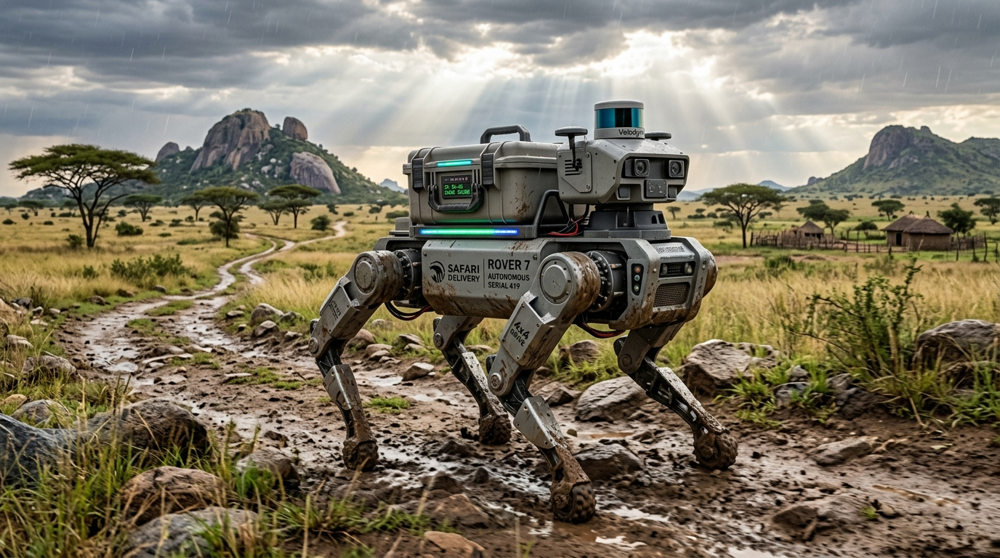
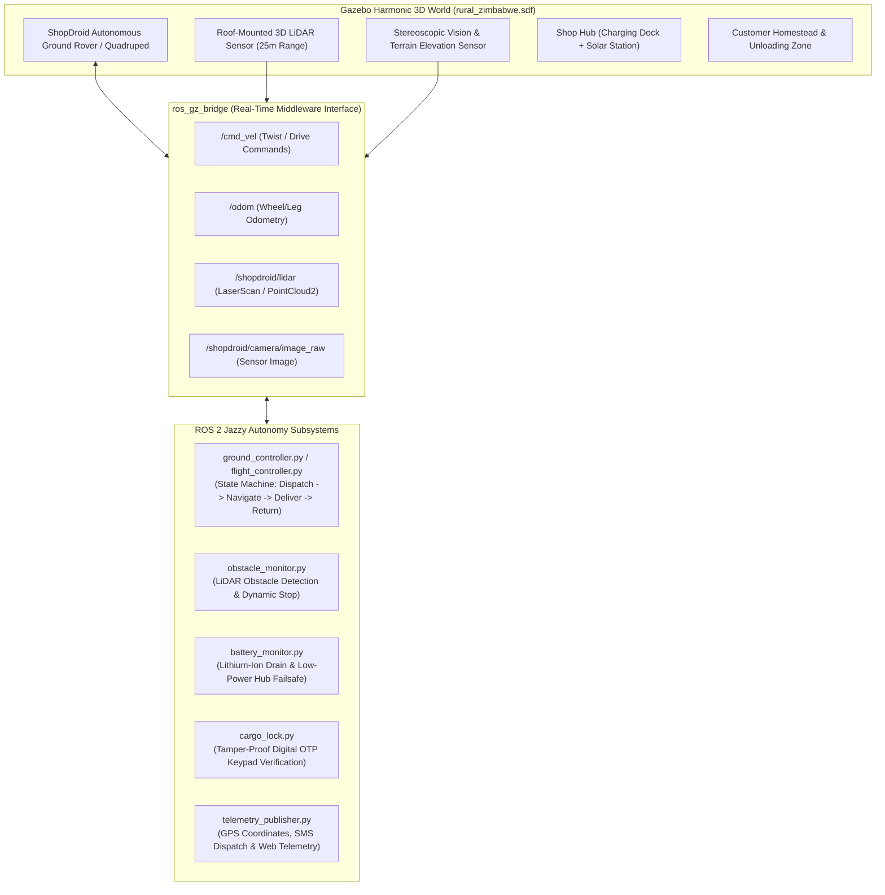

# ShopDroid: Autonomous Rural Terrain Delivery Droid (ROS 2 & Gazebo)

[](https://docs.ros.org/en/jazzy/index.html)
[](https://gazebosim.org/docs/harmonic)
[](https://www.nust.ac.zw)
[](collaborators.md)
[](AGENTS.md)

> **Project Lead / Author:** Mphathisi Ndlovu (`n02529052a@nust.ac.zw`)  
> **Institution:** National University of Science and Technology (NUST), Zimbabwe  
> **Documentation:** [Collaborators Directory](collaborators.md) | [Agent Instructions](AGENTS.md) | [Simulation Guide](docs/ShopDrone_Simulation_Guide.html)

---

## Concept Overview: The Terrestrial Delivery Droid


*Figure 1: ShopDroid Concept — An autonomous all-terrain robotic droid (mechanical quadruped / rugged rover) traversing rocky, unpaved terrain and harsh weather in rural Zimbabwe to deliver critical goods directly to homesteads.*

---

## 1. Executive Summary & Strategic Pivot

### The Shift: From Aerial Multirotor to Autonomous Ground Droid
The project initially prototyped an aerial multirotor drone (**ShopDrone**). Following in-depth regulatory, logistical, and environmental analysis, the project has **pivoted to an autonomous, all-terrain terrestrial droid (**ShopDroid**)** — designed like an autonomous "mechanical horse" or heavy-duty all-terrain rover:

```mermaid
graph LR
    A["Aerial Drone (ShopDrone)"] -->|Regulatory Friction & Airspace Licensing| B["Ground Delivery Droid (ShopDroid)"]
    A -->|Payload Constrained (< 2.5 kg)| B
    A -->|Grounded by Wind, Rain, Storms| B
    
    B --> C["No Commercial Airspace Licensing Required"]
    B --> D["Higher Payload (15 - 30 kg Critical Goods)"]
    B --> E["All-Weather Resilience (Rain, Mud, Heat, Wind)"]
    B --> F["Fail-Safe Ground Stability & Energy Efficiency"]
```

### Why a Terrestrial Droid?
1. **Regulatory Accessibility:** In Zimbabwe and across the globe, commercial drone delivery is governed by stringent Civil Aviation Authority (CAA) regulations, requiring licensed remote pilots, restricted aerial corridor approvals, and Beyond Visual Line of Sight (BVLOS) waivers. A ground droid operates within ground transport and pedestrian robotics jurisdictions, enabling rapid community deployment.
2. **Weather Resilience:** Southern African rural regions experience intense convective thunderstorms, high crosswinds, and torrential rainfall that ground multirotor UAVs. ShopDroid is engineered with an IP66/IP67 weatherproof chassis that traverses mud, waterlogged paths, and dust storms without downtime.
3. **Payload & Utility:** Drones cannot carry family-sized bulk groceries or heavy emergency medical equipment (e.g., fluid sacks, orthopedic casts, anti-venoms, battery packs). ShopDroid supports 15–30 kg of cargo.
4. **Safety & Fail-Safe Mechanics:** If a drone encounters a power or motor failure, catastrophic aerial drops threaten people and livestock. If a ground droid encounters a fault, it engages dynamic brakes, activates hazard lights, and remains securely parked.

---

## 2. Problem Statement

Rural communities across Zimbabwe and sub-Saharan Africa face severe logistical isolation:
- **Impassable Roads:** Heavy summer rains wash away dirt tracks and submerge low-lying river bridges, cutting off homesteads from regional business growth points and shopping centers.
- **Excessive Travel Costs:** Families must walk 10–25 km or pay exorbitant minibus fares simply to purchase basic pantry goods, hygiene essentials, or prescription medicines.
- **Healthcare Supply Chain Delays:** Rural clinics frequently run out of emergency medical supplies, snake anti-venoms, and chronic medications due to delayed supply vehicles that cannot navigate rocky or sandy terrain.
- **Conventional Vehicles Fail:** Standard cars and delivery vans cannot access off-grid rural homesteads situated across rocky granite kopjes, sandy tracks, and eroded paths.

---

## 3. Aim & Objectives

### Project Aim
To design, simulate, and develop **ShopDroid** — an autonomous, rugged terrestrial delivery droid capable of traversing rough, unpaved rural terrain and adverse weather to reliably transport critical goods from local shops to rural homesteads without human driving.

### Specific Objectives
1. **All-Terrain Mechanical Locomotion:** Model and simulate high-clearance locomotion (high-articulation quadruped legs / rocker-bogie all-wheel drive) capable of clearing boulders, traversing 30° slopes, and plowing through muddy tracks.
2. **Autonomous Navigation in Unstructured Environments:** Implement 3D LiDAR, stereo cameras, and ROS 2 Nav2 algorithms to generate real-time elevation maps, avoid dynamic obstacles (livestock, pedestrians, fallen branches), and navigate without marked road lanes.
3. **Secure Weatherproof Cargo Compartment:** Design an electronic lock payload bay protected by a 4-digit One-Time PIN (OTP) keypad, ensuring goods reach verified recipients and preventing tampering.
4. **Intelligent Power Management & Telemetry:** Build a smart Battery Management System (BMS) with regenerative braking, real-time battery drain calculation, return-to-hub failsafes, and cellular/LoRa telemetry tracking.
5. **High-Fidelity Virtual Twin Simulation:** Construct a realistic Gazebo Harmonic physics world modeling rural Zimbabwean topography, terrain friction, obstacles, and an end-to-end mission delivery loop.

---

## 4. System Architecture



---

## 5. Functional Feature Traceability Matrix

The simulation directly realizes the engineering requirements for autonomous rural delivery:

| Feature Area | Subsystem | Simulation Implementation |
| :--- | :--- | :--- |
| **Autonomous Navigation** | State Machine & Waypoints | `flight_controller.py` / `ground_controller.py`: Dispatches from Shop Hub, navigates rural waypoints, docks at customer gate, and executes Return-to-Hub (RTH). |
| **Perception & Collision Avoidance** | 3D LiDAR / Range Monitoring | `obstacle_monitor.py`: Continuously monitors a 25m forward cone; automatically halts drive when animals, humans, or boulders enter safety buffers. |
| **Tamper-Proof Payload Latch** | Digital Security Lock | `cargo_lock.py`: Solenoid latch locked during transit. Unlocks exclusively upon entering the recipient's 4-digit OTP (`4921`) with a 3-strike tamper alarm. |
| **Energy & Failsafe Management** | BMS Simulation | `battery_monitor.py`: Models motor discharge under rough terrain load and triggers emergency abort/RTH if battery falls below 25%. |
| **Live Telemetry & Tracking** | Low-Bandwidth Fleet Monitor | `telemetry_publisher.py`: Publishes standard ROS 2 `NavSatFix` GPS coordinates, GSM/SMS dispatch payloads, and mission progress. |
| **Full Mission Orchestration** | End-to-End Delivery Flow | `mission_runner.py` / `run_demo_cli.py`: Interactive and scripted mission cycles from order intake to confirmed delivery. |

---

## 6. Installation Guide

### Option A: Native Host (Ubuntu 24.04 LTS / Linux Mint 22.1)

Run the included automated installer script:

```bash
cd "group project gazebo"
sudo ./install_ros2_jazzy_gazebo.sh
```

This script:
1. Configures the Ubuntu `noble` repository and ROS 2 Jazzy GPG keys.
2. Installs `ros-jazzy-desktop`, `ros-jazzy-ros-gz` (Gazebo Harmonic bridge), and build tools (`python3-colcon-common-extensions`).
3. Automatically sets up workspace sourcing in `~/.bashrc`.

### Option B: Docker Environment (Zero-Install / Non-Root)

To run inside an isolated Docker container with X11 display forwarding:

```bash
cd "group project gazebo"
./docker/run_sim_docker.sh
```

---

## 7. Building the ROS 2 Workspace

Once ROS 2 Jazzy is sourced:

```bash
cd "group project gazebo/ros2_ws"

# Source ROS 2 Jazzy
source /opt/ros/jazzy/setup.bash

# Build the workspace
colcon build --symlink-install

# Source workspace overlay
source install/setup.bash
```

---

## 8. Execution Instructions

### A. Run Full 3D Gazebo Simulation & ROS 2 Subsystems
### A. Launch 3D Physics Simulation in Gazebo Harmonic
Launches the high-fidelity rural Zimbabwean 3D environment, bridges sensors and actuators, and starts the autonomous delivery droid (`ShopDroid`):

```bash
# Launch default ShopDroid terrestrial delivery droid simulation
ros2 launch shopdrone_simulation simulation.launch.py

# Or run the dedicated droid launch file
ros2 launch shopdrone_simulation simulation_droid.launch.py

# Alternatively, launch legacy aerial multirotor mode
ros2 launch shopdrone_simulation simulation.launch.py robot_type:=drone
```

To simultaneously launch **RViz2** with preconfigured LiDAR point clouds, odometry path, and sensor streams:

```bash
ros2 launch shopdrone_simulation simulation.launch.py rviz:=true
```

### B. Run Interactive Mission Dashboard
To orchestrate a complete live delivery mission:

```bash
ros2 launch shopdrone_simulation mission_demo.launch.py
```

### C. Run Standalone Prototype Demo (Instant CLI Visualizer)
To test and visualize the end-to-end delivery cycle instantly in the terminal (zero GPU/display overhead):

```bash
# ShopDroid Ground Rover Visualizer (Default)
python3 ros2_ws/run_demo_cli.py

# Legacy ShopDrone UAV Visualizer
python3 ros2_ws/run_demo_cli.py --drone

# Fast headless verification
python3 ros2_ws/run_demo_cli.py --test-mode
```

### D. Run Automated Verification & Logic Test Suite
```bash
python3 ros2_ws/test_prototype.py
```

---

## 9. Project Directory Structure

```
group project gazebo/
├── README.md                          # Primary project documentation (this file)
├── collaborators.md                   # Collaborator directory, roles & onboarding
├── AGENTS.md                          # AI agent operating guidelines & instructions
├── install_ros2_jazzy_gazebo.sh       # Automated installer for ROS 2 Jazzy + Gazebo
├── docker/
│   ├── Dockerfile                     # Docker container recipe
│   └── run_sim_docker.sh              # Docker launch script with X11 display support
├── docs/
│   ├── images/
│   │   └── rural_delivery_droid_concept.jpg # Concept render of the delivery droid
│   └── ShopDrone_Simulation_Guide.html # Interactive documentation & simulation guide
└── ros2_ws/                           # ROS 2 Colcon Workspace
    ├── test_prototype.py              # Automated unit and integration test suite
    ├── run_demo_cli.py                # Standalone interactive prototype visualizer
    └── src/
        └── shopdrone_simulation/      # ROS 2 package
            ├── package.xml            # Package manifest
            ├── setup.py               # Package build script
            ├── launch/
            │   ├── simulation.launch.py       # Spawns Gazebo + ROS 2 bridges (supports robot_type:=droid/drone)
            │   ├── simulation_droid.launch.py # Dedicated ShopDroid ground delivery launch
            │   └── mission_demo.launch.py     # Mission orchestrator launch
            ├── models/
            │   ├── shopdroid/         # High-clearance 4WD All-Terrain Droid SDF model
            │   ├── shopdrone/         # Baseline UAV simulation model
            │   └── ...                # Hub, homestead, and terrain models
            ├── worlds/
            │   └── rural_zimbabwe.sdf # 3D Gazebo environment (kopjes, homesteads, dirt tracks)
            └── shopdrone_simulation/
                ├── ground_controller.py   # Autonomous terrestrial waypoint & obstacle navigation
                ├── flight_controller.py   # Legacy autopilot state machine
                ├── cargo_lock.py          # 4-Digit OTP unlock & tamper security
                ├── battery_monitor.py     # Battery discharge & failsafe logic
                ├── obstacle_monitor.py    # LiDAR collision detection
                └── telemetry_publisher.py # GPS / SMS telemetry node
```

---

## 10. Collaboration & Contributing

- **Human Collaborators:** Please read [collaborators.md](collaborators.md) for team directories, working group assignments, and onboarding checklists.
- **AI Coding Agents:** Please consult [AGENTS.md](AGENTS.md) for architecture rules, code standards, and verification requirements.

---

## 11. Academic Citation & Acknowledgments

Developed as part of the Robotics and Autonomous Systems research initiative at the **National University of Science and Technology (NUST)**, Bulawayo, Zimbabwe.
