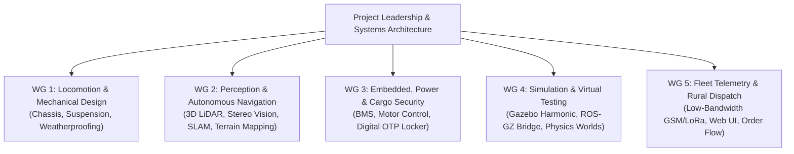

# Project Collaborators & Team Directory

Welcome to the **ShopDroid (Autonomous Rural Delivery Droid)** project directory. This document registers all active contributors, team leads, academic supervisors, and incoming collaborators across engineering domains.

---

## 1. Project Leadership & Academic Supervision

| Name | Role | Affiliation | Contact / GitHub | Focus Area |
| :--- | :--- | :--- | :--- | :--- |
| **Mphathisi Ndlovu** | **Project Lead & System Architect** | National University of Science and Technology (NUST), Zimbabwe | `n02529052a@nust.ac.zw` | End-to-End System Architecture, ROS 2 & Gazebo Simulation, Autonomy State Machines |
| *Faculty Supervisor (TBD)* | Academic Advisor | Department of Computer Science / Mechatronics, NUST | `advisor@nust.ac.zw` | Project Oversight, Research Compliance & Review |

---

## 2. Active & Incoming Collaborator Directory

*New team members joining the project should submit a pull request adding their details to this table.*

| Name | Role / Sub-team | Affiliation | Contact / Handles | Primary Responsibilities | Status |
| :--- | :--- | :--- | :--- | :--- | :--- |
| *Collaborator Name* | Robotics Software Engineer | NUST / Partner Org | `email@example.com` / `@handle` | Perception & Obstacle Avoidance (3D LiDAR SLAM) | *Onboarding* |
| *Collaborator Name* | Mechanical & Locomotion Engineer | NUST / Partner Org | `email@example.com` / `@handle` | Chassis Kinematics, High-Clearance Suspension, Terrain Compliance | *Onboarding* |
| *Collaborator Name* | Embedded Systems Engineer | NUST / Partner Org | `email@example.com` / `@handle` | BMS Power Electronics, Motor Drivers & Hardware Security (OTP Lock) | *Onboarding* |
| *Collaborator Name* | Simulation & World Designer | NUST / Partner Org | `email@example.com` / `@handle` | Gazebo Harmonic Terrain Meshes, Weather & Mud Dynamics | *Onboarding* |
| *Collaborator Name* | Telemetry & Dispatch Developer | NUST / Partner Org | `email@example.com` / `@handle` | Web/SMS Dispatch UI, Remote Monitoring, Route Optimization | *Onboarding* |

---

## 3. Engineering Working Groups

To streamline collaboration across hardware, physics simulation, and autonomous logic, the project is organized into five specialized working groups:



### WG 1: Locomotion & Mechanical Design
- **Objective:** Develop high-clearance, terrain-compliant ground locomotion (quadruped legs or articulating rocker-bogie wheel drive) capable of clearing boulders, mud ruts, and steep gradients.
- **Key Deliverables:** URDF/SDF kinematics models, physical chassis stress analysis, IP66/IP67 ingress protection against rain and sand.

### WG 2: Perception & Autonomous Navigation
- **Objective:** Deliver robust ground navigation in unstructured rural environments lacking marked roads or lane lines.
- **Key Deliverables:** Nav2 configuration, point-cloud elevation mapping for slope/step detection, obstacle clustering, fallback recovery behaviors.

### WG 3: Embedded, Power & Cargo Security
- **Objective:** Design energy-efficient power distribution and secure physical payload handover.
- **Key Deliverables:** Smart Battery Management System (BMS) with regenerative braking models, weatherproof 4-digit PIN OTP cargo latch with tamper trip-wire.

### WG 4: Simulation & Virtual Testing
- **Objective:** Provide a digital-twin testing ground replicating rural African environments.
- **Key Deliverables:** Photorealistic Gazebo Harmonic SDF worlds with rocky dirt roads, kopjes, river crossings, unpredictable weather (rain, mud friction), and automated integration tests.

### WG 5: Fleet Telemetry & Rural Dispatch
- **Objective:** Enable shopkeepers and rural homesteads to order, track, and receive deliveries reliably even with sparse mobile connectivity.
- **Key Deliverables:** Cellular GSM / LoRa telemetry packet protocol, lightweight dispatch dashboard, and SMS notifications.

---

## 4. Collaborator Onboarding Steps

If you are joining the project, please follow this checklist:

1. **Clone the Repository:**
   ```bash
   git clone https://github.com/<org-or-user>/group-project-gazebo.git
   cd group-project-gazebo
   ```
2. **Review the Core Guidelines:**
   - [README.md](file:///home/mphatic/Desktop/group%20project%20gazebo/README.md) for the project scope, problem statement, and setup instructions.
   - [AGENTS.md](file:///home/mphatic/Desktop/group%20project%20gazebo/AGENTS.md) for automated agent interaction standards and engineering rules.
3. **Setup Your Environment:**
   - Execute the native setup: `./install_ros2_jazzy_gazebo.sh`, or build the Docker image in `docker/`.
4. **Register Your Profile:**
   - Create a branch: `git checkout -b chore/add-collaborator-<yourname>`
   - Add your name, affiliation, and role to Section 2 of this document.
   - Submit a Pull Request for review by the Project Lead.
5. **Join Team Comms:**
   - Check the project communication channel (WhatsApp group / Discord / Slack) for sprint updates.

---

## 5. Collaboration Etiquette & Rules

1. **Protect the Main Branch:** Never commit directly to `main` without testing simulation builds (`colcon build`) and running `python3 ros2_ws/test_prototype.py`.
2. **Modular Changes:** Keep pull requests focused on a single feature, model, or bug fix.
3. **Respect Academic Standards:** All algorithmic contributions and models must cite relevant literature or open-source licenses where applicable.
4. **AI Agent Collaboration:** When working with AI coding agents (such as Antigravity, Gemini, or Claude), ensure the agent adheres to the instructions in [AGENTS.md](file:///home/mphatic/Desktop/group%20project%20gazebo/AGENTS.md).
